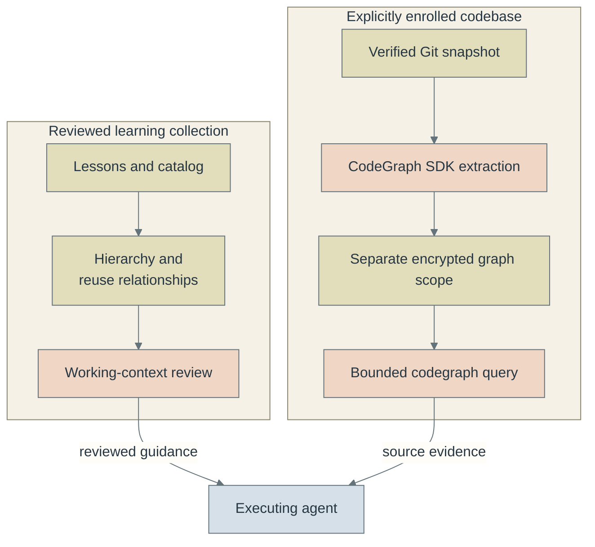

# Architecture and concepts

Identity owns a collection of reviewed knowledge and evidence. Witful is the
library and CLI that validates, retrieves and records it. An executing agent uses
those outputs within the permissions supplied by its host and the user.

These diagrams describe implemented responsibilities and interfaces. Arrows show
ownership or named data flow, not automatic execution or permission grants.

## Reading the diagrams

The palette complements the [README logo](assets/identity-logo.png): muted blue
for components and ownership, copper for work and review, and olive for retained
records and state. Pale node fills and charcoal labels preserve contrast; sequence
diagrams use a light canvas to remain readable on a dark viewer background. Color supports the named roles;
it does not indicate a permission grant, completion or safety guarantee.

The [native storage views](native/diagrams/README.md) use the same palette with
an explicit state legend. Their existing labels distinguish authoritative state,
pending work, projections, disposable caches and services.

## The knowledge hierarchy

What owns a teaching, and where does a concrete finding belong?

```mermaid
---
config:
  theme: base
  look: classic
  themeVariables:
    background: '#fffdf8'
    primaryColor: '#d6e0e9'
    primaryTextColor: '#263642'
    primaryBorderColor: '#65737b'
    secondaryColor: '#efd6c5'
    tertiaryColor: '#f5f1e7'
    tertiaryTextColor: '#263642'
    tertiaryBorderColor: '#8b846d'
    lineColor: '#65737b'
    textColor: '#263642'
    clusterBkg: '#f5f1e7'
    clusterBorder: '#8b846d'
    edgeLabelBackground: '#fffdf8'
---
flowchart LR
    identity["Identity"]
    discipline["Discipline"]
    skill["Skill"]
    lesson["Lesson"]
    insight["Insight"]
    identity -->|owns| discipline
    discipline -->|groups| skill
    skill -->|contains| lesson
    lesson -->|has| insight
    classDef olive fill:#e2ddba,stroke:#65737b,color:#263642
    class skill olive
    classDef copper fill:#efd6c5,stroke:#65737b,color:#263642
    class lesson,insight copper
```

An Identity owns the collection; a Discipline groups an area of practice; a Skill
groups a reusable capability; a Lesson preserves a sourced teaching; an Insight
records a concrete finding under that teaching. Each concept has one canonical
location in the hierarchy. Separate relationships allow reuse without copying a
Lesson or moving its ownership:

| Relationship | Meaning |
| --- | --- |
| `requires` | The source concept depends on the target; the context resolver follows that direction. |
| `related` | An explicitly described connection, considered as optional context. |
| `transfers` | A proposed reuse connection; it is not evidence of successful application. |

The [typed model](../pkg/witful/knowledge/models.py) keeps these relationships
separate from containment. The [compiler](../pkg/witful/knowledge/compiler.py)
combines the original lesson journal with reviewed catalog assignments and
annotations. Corrections retain the earlier teaching through explicit supersession;
unknown topics remain visible as Unclassified. The hierarchy is an organizational
model, not a score of competence or truth.

## Guidance and code evidence

How do learned practices and repository facts reach an agent without becoming the
same kind of knowledge?

The two paths are separate interfaces. `witful context` selects guidance from the
learning hierarchy. `witful codegraph query` returns symbols, relationships and
source spans from an enrolled repository. Their arrows to the agent describe
explicit caller use; there is no automatic CodeGraph injection into context
receipts or model prompts. Sharing the context-budget type does not merge these
stores or promote extracted code into Lessons.

An Insight requires a sourced observation and deliberate recording. An index
refresh does not create one. Likewise, a matching concept, source span or complete
review receipt does not authorize an action. See the
[context review flow](context.md#review-flow) and
[CodeGraph custody and query flows](codegraphs.md#architecture-and-isolation).

## Records describe different observations

These records can reference the same concepts while answering different questions.
They are not interchangeable measures of learning.

| Record or view | What it establishes | Guide |
| --- | --- | --- |
| Lesson and Insight | What was taught or observed, with its source and corrections | [Hierarchy terminology](WITFUL.md#hierarchy-terminology) |
| Application | Reported use of named concepts for a task, with outcome evidence | [Witful responsibilities](WITFUL.md#responsibilities) |
| Life decision | A recorded choice and the knowledge snapshot used for replay | [Decisions and replay](CLI.md#life-overview) |
| Repertoire observation | Actual use of a tool for a classified problem | [Tool repertoire](CLI.md#toolbox-and-problems) |
| Project checkpoint | The collection evidence and project revision at a visit | [Project chapters](checkpoints.md) |
| Instance and task events | Observed runtime provenance, action outcomes and pending work | [Instances](instances.md) |
| Context receipt | Review of guidance selected for one work step | [Working context](context.md) |
| Completion receipt | Review coverage of the full current hierarchy and selected workspaces | [Completion audits](completion.md) |

Plots are derived views of these records. Counts reflect recorded observations;
they do not infer missing activity. Source journals, retained snapshots and
reviewed classifications remain the authority behind a view.

## Storage and execution boundaries

The collection transport and native service are distinct operating paths. The
collection workflow encrypts and signs reviewed file snapshots for Git and CI.
The native service provides admitted operations over encrypted records in a
configured Git or PostgreSQL backend, with a separate authority and key broker.
CodeGraph uses the native service and reserves its own scope per enrolled codebase.
Neither path is silently enabled by installing Witful.

| Diagram | Question it answers |
| --- | --- |
| [CodeGraph architecture and isolation](codegraphs.md#architecture-and-isolation) | Where is source readable, and what can the SDK worker reach? |
| [CodeGraph retrieval](codegraphs.md#query-lifecycle) | Which checks precede release of bounded source evidence? |
| [Working-context review](context.md#review-flow) | How do task inputs become individually reviewed guidance? |
| [Completion review](completion.md#review-lifecycle) | What distinguishes coverage checks from completing the task? |
| [Encrypted collection publication](private-collections.md#publication-boundaries) | What stays local, what reaches Git, and when can CI decrypt it? |
| [Concurrent session reconciliation](multisleeving.md#session-and-storage-relationships) | How do isolated sessions retain evidence and reconcile with main? |
| [Native storage views](native/diagrams/README.md#views) | How do authority, ciphertext, acknowledgment, projection and recovery relate? |

The native views carry source and configuration digests in their manifest. The
inline diagrams link their implementation beside the explanation and are checked
by the repository's pinned Mermaid hook. Syntax validation does not replace
reviewing arrow meaning, source accuracy or rendered layout.
