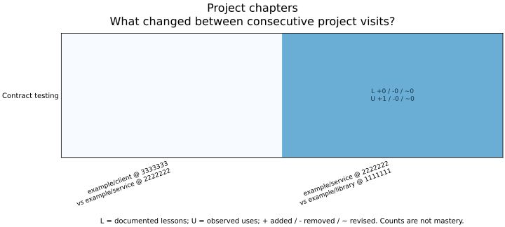

# Project checkpoints

A checkpoint is a moment to review the current chapter: documented teachings,
revisions, and actual skill applications. It records the project's Git commit
and the collection's evidence at recording time. A repository switch or extra
commit does not itself establish learning.

## Skill: maintaining project chapters

Keep one checkpoint per project touched during meaningful work. For a task spanning
several repositories, record each project's committed HEAD separately in the owning
collection, after its evidence is recorded. Updating the last repository alone loses
the other boundaries. Use the existing work ledger to reconcile omissions; do not
scan unrelated repositories or manufacture historical snapshots.

A catch-up review records current evidence and current recording time. It cannot
attribute changes since an old checkpoint to a particular intervening project.
Document that gap, retain zero-change visits, and record future boundaries as the
work happens. Generated-only publication commits need no new checkpoint, avoiding
an endless refresh loop. Merely recording a checkpoint is not a skill application.

Keep each collection independent. Public library examples are synthetic; never copy
personal journals into upstream documentation. Private publication follows the
collection's encryption and readable-figure policy.

## Record a boundary

After recording the lessons and applications from a task, run:

```bash
witful checkpoints --repo /path/to/collection record \
    --project /path/to/project --project-id example/project
```

Use a stable project alias. No remote URLs, source files, commit messages,
authors, or machine paths are captured from the project. Git supplies only its
committed HEAD. Uncommitted project edits are not represented by that SHA; record
after the relevant commit when commit-level traceability matters. The collection
snapshot includes its current reviewed sources, even if not yet committed.

Record at the end of a project visit, before changing projects, and after
meaningful evidence updates within that project. Add the same command to an
opt-in local post-commit hook if every source commit should establish a boundary.
Witful does not install hooks, scan unrelated repositories, or monitor editor focus.
A Git commit in a different repository cannot notify this collection by itself.

The first checkpoint establishes the baseline. Repeating an identical immediate
record operation is a no-op. A new commit, changed evidence, or return from
another project creates a new checkpoint. Recording appends
`knowledge/checkpoints.jsonl` and updates the local SQLite mirror; it does not
render plots or contact PostgreSQL. Commit the reviewed journal with the collection.

## Compare chapters

```bash
witful checkpoints check
witful checkpoints diff
witful checkpoints diff --before CHECKPOINT_ID --after CHECKPOINT_ID
witful checkpoints build --limit 8
```

`diff` defaults to the last two commit checkpoints. Consecutive checkpoints in
one project collapse to the final state of that visit in the overview; returning
to the project later creates a separate visit. Order follows the immutable journal,
not Git author dates. The most recent transition is shown first.

`build` writes two SVG/PNG views and a complete JSON export to `docs/assets/`:

- `checkpoint-transitions`: changes between consecutive project visits.
- `checkpoint-comparisons`: the latest state compared with each earlier visit.
- `checkpoints.json`: every snapshot, commit-to-commit diff, and historical comparison.

The display limit is 1-20 comparisons, default 8. It does not discard history
from the export. New and removed fact IDs are set differences; shared IDs with
changed content hashes are revisions. Cells show `+ added / - removed / ~ revised`
separately for teachings (L) and applications (U). Initial state is never counted
as newly acquired knowledge. No change preserves the project labels with an explicit "No changes" row.

Applications roll up to each skill once per task/context, including applications
of its lessons or insights. Later complete task observations revise the same key.
Active teachings exclude explicitly superseded records. Lesson hashes include
insight annotations, so extensions remain visible. Skill additions, removals, and
renames have explicit statuses. Reclassification can move facts between skills;
it is a structural change, not evidence of new learning or project causality.
Raw counts measure recorded evidence, not intelligence, proficiency, or everything
that happened between checkpoints.

## Reproduce the public example



This example contains invented projects and evidence, including an unchanged visit.
Regenerate it from the committed fixture without accessing a personal collection:

```bash
witful checkpoints --repo examples/project-chapters check
witful checkpoints --repo examples/project-chapters build --output-dir ../../docs/assets/project-chapters
```

## Database mirror and recovery

`witful checkpoints sync` mirrors the journal into
`.witful/checkpoints.sqlite3`, separate from the disposable lesson search index.
Setting `WITFUL_DATABASE_URL` selects the existing PostgreSQL database for this
explicit sync command. Both engines use `witful_checkpoints`, partitioned by
`WITFUL_DATABASE_NAMESPACE`, with unique record IDs and sequence positions.
Namespace separation is not access control. PostgreSQL follows the TLS and timeout
contract in [storage](storage.md).

Compatible prefixes and repeated seeds are safe. Divergent history fails without
replacing records; reconcile the reviewed source before seeding. Local recording
persists the journal first, so an interrupted mirror update can be repaired with
`sync`. To rebuild a corrupt local mirror, retain the journal, remove only the
local checkpoint database, then sync. Never delete or reorder source events to
make a mirror accept them. `build --from-database` and `diff --from-database` use
the selected database without current collection files.

Checkpoints retain project aliases, commit IDs, recording times, skill labels,
and evidence keys/digests. They do not retain lesson/application text. Digests
are fingerprints, not anonymization or encryption. Keep private collections and
their generated images private. The hash chain detects accidental corruption;
it is not an authenticated signature against someone able to rewrite all records.

## Refresh in Actions

Run source validation on PRs. On main, run `checkpoints schemas`, `checkpoints
sync`, and `checkpoints build` alongside the existing knowledge, Life, and toolbox
generators. Keep render work independent from tests; gate publication on both.
Stage only generated schema and artifact paths, commit only changed bytes, and
push without force. A stale branch must fail rather than overwrite newer work.
Use the workflow's `GITHUB_TOKEN` for artifact commits so those commits do not
recursively start another push workflow. Branch protections may require a reviewed
artifact PR or an explicitly authorized bypass identity.

Do not cache private databases in shared Actions caches. Commit the reviewed
JSONL source; recreate SQLite on each runner. Standard work only records evidence
and validates it locally. CI renders the views; local rendering is reserved for
renderer development and visual verification.
