# CodeGraph development custody setup

`witful codegraph setup` prepares a dedicated 1Password vault for the separately
deployed key broker. It is an optional operator command. Within that command,
creating missing resources is enabled by default to simplify development setup.
Installation, CLI help, graph builds and queries never provision credentials.

Install and authenticate [1Password CLI](https://www.1password.dev/cli/get-started/)
using the desktop app or `op signin`. Select your account explicitly and choose a
private directory on verified encrypted storage outside Git:

```bash
witful codegraph setup \
  --account ACCOUNT \
  --directory "$HOME/.local/share/witful/codegraph/my-repository"
```

The default vault is `Witful CodeGraph Development`. Setup creates or reuses two
separate key items and a read-only, vault-scoped service account that expires after
30 days. An existing vault's sharing policy is preserved; review its membership
before storing keys. Prefer a dedicated vault because a service account can read
every item in its authorized vault. Store unrelated credentials elsewhere.

Success reports that custody references were verified and saved. It does not
mean services are running or a repository has been enrolled. Continue with
[native runtime configuration](native-storage.md),
[separate authority administration](native-operations.md) and
[CodeGraph enrollment](codegraphs.md#enrollment-inputs).

## Reuse existing locations

Use `--vault` with a vault name or ID. Disable every creation path with
`--no-provision`. Existing purpose-named items are discovered automatically;
explicit stable field references select different items:

```bash
witful codegraph setup --account ACCOUNT \
  --directory "$HOME/.local/share/witful/codegraph/my-repository" \
  --vault VAULT_ID --no-provision \
  --wrapping-reference op://VAULT_ID/WRAPPING_ITEM_ID/credential \
  --signing-reference op://VAULT_ID/SIGNING_ITEM_ID/credential \
  --token-reference op://VAULT_ID/SERVICE_ACCOUNT_ITEM_ID/credential
```

The two key items require string fields `generation` (a canonical UUID) and `kind`
(`wrapping` or `signing`). Their credential field contains base64 PKCS8 DER, matching
the [broker's key contract](https://github.com/astrivant/1password-agent-broker/blob/main/docs/key-service.md).
The token reference must contain an existing usable service-account token. Setup
validates its presence; the broker's live readiness check establishes provider
access. Supplied tokens retain their existing permissions and expiry, which the
operator must review. No secret value belongs in a command argument.

## Responsibilities and secret flow

```mermaid
---
config:
  theme: base
  themeVariables:
    primaryColor: '#d6e0e9'
    primaryTextColor: '#263642'
    primaryBorderColor: '#65737b'
    secondaryColor: '#efd6c5'
    tertiaryColor: '#f5f1e7'
    lineColor: '#65737b'
---
flowchart LR
    operator["Authenticated operator"] --> setup["Explicit setup command"]
    setup -->|"captured pipes: op"| vault["Dedicated 1Password vault"]
    setup -->|"references and public pins only"| receipt["Private local receipts"]
    broker["Separate broker runtime"] -->|"official SDK: scoped token"| vault
    controller["Native controller"] -->|"broker SDK: scoped mTLS"| broker
    receipt -->|"reviewed configuration"| controller
```



`op` owns operator authentication and provisioning, including service-account
creation. The running broker continues to use the official 1Password SDK. Witful's
controller uses only the lightweight broker SDK; setup does not install the broker
server into the controller environment or put an operator session there.

Credential item payloads travel through stdin. Captured secret responses are never
printed, logged or stored in the setup directory. Subprocess errors omit provider
output. The directory is owner-only, uses a local setup lock and contains only
public key metadata, stable references and recovery markers. References still
reveal account/vault relationships, so keep these receipts private.

New signing keys use Ed25519. New wrapping keys use RSA with the maximum size
accepted by the released broker, selected in the
[generator](../pkg/witful/codegraph/setup/custody.py). Existing valid keys are
preserved. Key generation uses `cryptography` and operating-system randomness;
public source code does not contain or determine the generated private values.

These are classical cryptographic algorithms. Larger RSA keys and elliptic-curve
keys do not resist sufficiently capable quantum computers. Post-quantum protection
requires compatible protocols and standardized algorithms, not a larger key-size
setting. See [NIST's migration FAQ](https://pages.nist.gov/nccoe-migration-post-quantum-cryptography/).

## Retries, recovery and admission

Setup never rotates an existing key, overwrites a changed public pin or renews an
expired service account silently. A retry reconciles existing vault items before
creating anything. Duplicate names require explicit IDs or operator correction.
Use a separate setup directory and reviewed rotation procedure when changing keys.
Run only one provisioning operator per vault; the directory lock does not serialize
other machines or administrators.

Service-account creation returns its token only once. Setup saves it immediately
in the vault and retains `service-account.pending` if that operation is interrupted.
If no saved token can be recovered, revoke the orphan account in 1Password before
removing that marker and retrying. Never paste a token into a diagnostic or issue.
Cancel an interactive authentication prompt normally; preserve partial receipts.

Custody setup cannot attest a host's protection. The native runtime still requires
reviewed, signed deployment evidence covering storage, working memory, role
separation, recovery and graph-specific access. Separate processes on one developer
machine are not independently administered production services.

The default memory control is `temp-memory-noswap`. For an explicitly accepted
macOS development deployment, its signed evidence may substitute
`macos-encrypted-swap`. That profile checks FileVault working storage and macOS's
actual encrypted-swap status on each admission check. Other operating systems,
unencrypted swap and unverifiable metadata are rejected. This choice accepts
encrypted disk-backed memory; it does not claim memory never reaches disk.
The isolated Linux SDK worker retains its no-swap controls in either profile.

All other admission controls remain required. Setup does not sign the deployment
attestation automatically, and an existing no-swap attestation does not implicitly
select the macOS exception.

For a local CodeGraph demo, an operator may explicitly trust the host administrator
and substitute `local-development-administration` for `role-separation` in signed
evidence. This accepts that the administrator can change both runtime and custody
policy. It does not claim independently administered custody. The verifier confines
this choice to a loopback controller and broker, local Git storage, enrolled graphs,
and no configured export, migration, derivation or projection destinations.
Service credentials, mutual TLS, grant checks and all remaining protection controls
still apply. Ordinary deployment evidence retains independent role separation.

For larger or mixed-language repositories, select `profile: sdk` and review
`envelope.bytes`, `envelope.items` and `worker_bytes` alongside the enrollment's
source and worker limits. The full language and coverage contract is documented in
[CodeGraph enrollment](codegraphs.md#language-support-and-coverage). Native operation time, listener timeout,
client timeout and query `--elapsed-ms` must accommodate the actual broker and
indexing latency. These are separate bounds; increasing a worker limit does not
increase the storage or query budget. Renew signed evidence after changing settings.
