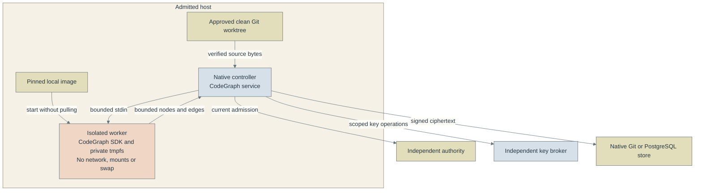
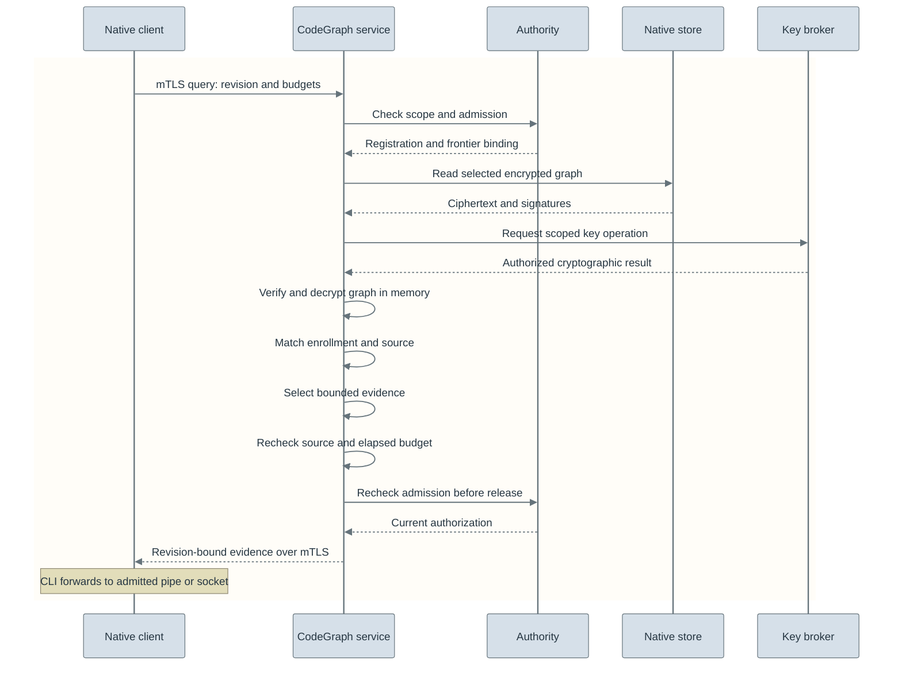

# Encrypted repository codegraphs

The optional CodeGraph extension retrieves bounded symbol and caller references
from an approved Python repository. Each codebase has a separate encrypted native
scope associated with one engineer's identity. Derived code facts remain separate
from lessons, skills, application counts and compiled guidance.

The local adapter follows [RFC #76](https://github.com/astrivant/product-research/pull/76).
Access is restricted to the owning engineer's admitted runtime. Installation does
not enroll repositories. Model-token reduction has not been measured.

## Architecture and isolation

Where can readable source exist, and which component can contact other services?



The network restriction applies to the SDK worker. The controller still contacts
its configured authority, broker and storage. Only verified Python source bytes
enter the worker; it receives no host-directory mount, broker credentials or
identity learning records. Source text and SDK index files are readable during
processing. The controller also handles readable graph data while sealing or
querying it; encryption at rest does not remove that trusted runtime boundary.

Docker is the adapter's isolation mechanism, not a CodeGraph SDK requirement or
the source of token savings. It adds a Docker dependency and per-build startup
cost. Image creation downloads pinned dependencies separately; indexing starts
only an already installed, explicitly enrolled image. Querying an existing graph
does not start the SDK container again, although it verifies current source bytes.

| Worker property | Purpose and actual boundary |
| --- | --- |
| Optional | Ordinary Witful operations do not install or run CodeGraph. |
| Locked | Source revision, dependency lock and enrolled image content ID identify the reviewed executable. |
| Bounded | Source, output, memory, process count and time limits constrain parser work; exhaustion fails the operation. |
| Disposable | Copied source and SDK SQLite files stay in tmpfs; cleanup removes the container after success, failure or cancellation. |
| No network | The indexing process cannot contact a telemetry or other remote endpoint; the host and Docker daemon remain trusted. |

The [snapshot reader](../pkg/witful/codegraph/snapshot.py),
[worker supervisor](../pkg/witful/codegraph/worker.py),
[SDK adapter](../services/codegraph/worker.mjs) and
[graph service](../pkg/witful/codegraph/service.py) own these boundaries.
Native storage retains the encrypted normalized graph and its history, not the
worker's SQLite database. See the [concept map](architecture.md) for the separate
roles of repository evidence, learned guidance and review receipts.

## Runtime and custody

For explicit development bootstrap, [CodeGraph setup](codegraph-setup.md) defaults
to provisioning dedicated 1Password custody. Use `--no-provision` to retrieve
existing locations. Ordinary builds and queries do not create keys or grants.

Use the [protected native runtime](native-storage.md) on an explicitly admitted
engineer's host. The independent authority and key broker remain separate services.
Give every graph a new opaque native identity scope, distinct from the engineer's
learning identity and every other repository. Provision native `write`,
`codegraph-build`, `codegraph-query` and `recover` grants only for that engineer's admitted
runtime certificate and task. Use independently scoped broker grants and wrapping
generations for that extension. Neither an employer nor a tenant administrator is
an additional authorized graph recipient. Build and query commands require existing keys and grants.

The operator must review the custody policy, including recovery, to establish that
only the engineer's admitted runtime can unwrap these records. If that cannot be
established, enrollment is unsupported. An operator's ability to edit policy or a
compromised attester is outside the claimed cryptographic guarantee. A signed
configuration is evidence of a reviewed deployment, not hardware attestation.

The same Flask application supplies graph routes, central mutual TLS, operational
metrics, admission limits and shutdown. Generic record, export, sharing and
derivation HTTP operations reject reserved graph scopes. Graphs cannot use
whole-identity recovery-sharing as an implicit disclosure path.

## Prepare the optional worker

The worker uses the upstream Node API from an immutable source archive and its
committed dependency lock. The corresponding npm release is a CLI shim, so it
cannot be substituted for this SDK build. Pins and archive integrity are maintained
in [the Dockerfile](../services/codegraph/Dockerfile), with upstream attribution
retained in the resulting image. The main Witful installation does not install Node
or CodeGraph. The SDK compatibility job runs separately from source checks.

```bash
docker build --tag witful-codegraph:local services/codegraph
docker image inspect --format '{{.Id}}' witful-codegraph:local
```

Record that immutable `sha256:` image ID in the enrollment. Builds use
`--pull=never`; missing images fail instead of downloading executable code during
private processing. The local Docker daemon is inside the admitted host boundary;
remote contexts and Docker-in-Kubernetes are unsupported.
The current Helm deployment therefore does not enable this local worker.

Every invocation uses a read-only image, no network, no mounts from the repository,
no Linux capabilities, no core dumps, no persistent container logs and bounded
memory/processes/time. Python source arrives through stdin and is copied into a
private, nonswappable `/work` tmpfs. SDK SQLite, WAL, journal, config and temporary
files stay there. Telemetry is disabled before SDK import. No repository installer,
hooks, filters, imported Python or instruction files execute. Timeout and cancellation
remove the named daemon-owned container, not merely its CLI parent.

## Enrollment inputs

Add an item to `codegraphs` in the independently approved native Settings object.
This configuration belongs on protected working storage; do not publish real
repository paths, scope mappings or owner bindings. The generated Settings and Helm
schemas include every input. Defaults disable the feature with an empty list.

| Input | Meaning |
| --- | --- |
| `tenant`, `extension` | Independently provisioned opaque native and key routing scope |
| `owner` | Owning learning identity UUID, retained as lineage without granting access |
| `subject` | SHA-256 of the admitted runtime's actual TLS certificate |
| `repository` | Existing canonical clean Git worktree on the admitted host |
| `image` | Reviewed local worker image content ID |
| `excluded` | Relative glob exclusions, applied before extraction |
| `retention` | Reviewed policy reference; no implicit deletion |
| `source_bytes`, `files` | Bounds for complete tracked input inspection |
| `seconds`, `memory_mb` | Worker lifetime and memory budgets |

Renew the native deployment evidence after changing settings. Enrollments additionally
require reviewed controls `graph-engineer-only-custody`,
`graph-runtime-egress-isolation`, `graph-source-rights` and `graph-output-sink`.
These cover the actual source permission, Docker host, key/grant isolation and
recipient's protected output handling. Existing evidence fails if it omits these
controls. Settings changes require evidence renewal because the signature binds the complete
effective configuration. Unchanged pre-extension evidence remains valid when
`codegraphs` is empty; that compatibility path never admits an enrolled graph.

## Build, retrieve and refresh

`ADMITTED_CONSUMER` below is the deployment's explicitly reviewed memory-only
consumer command. Do not substitute `tee`, an ordinary file redirect or a logging
agent runner; provision and attest the recipient before using private output.

Use an existing native client configuration whose `identity` is the extension
scope and whose certificate matches the enrollment. Results are transient plaintext delivered over an explicitly selected pipe to the
consumer covered by `graph-output-sink`. The CLI refuses terminals and regular-file
redirects, creates no result file and keeps no query cache. The consumer must not
log or retain plaintext. Encrypt/sign anything that must be persisted; a shell
pipe alone is not proof that its recipient follows that contract.

```bash
witful codegraph build --client /protected/graph-client.json \
  --revision COMMIT_SHA --operation OPERATION_UUID --initial \
  --pipe | ADMITTED_CONSUMER
witful codegraph query --client /protected/graph-client.json \
  --revision COMMIT_SHA --symbol target_function --direction callers \
  --depth 2 --nodes 40 --edges 100 --tokens 8000 --bytes 16000 \
  --pipe | ADMITTED_CONSUMER
```

Refresh with a new operation UUID and `--expected` set to the preceding query's
`generation`. A matching operation retry returns the original encrypted receipt;
changed retry inputs conflict. Interrupted or concurrent builds do not publish a
partial graph. Native authority fencing handles uncertain storage outcomes; an
operator can use `witful codegraph recover --client /protected/graph-client.json
--pipe | ADMITTED_CONSUMER` to reconcile an unsettled transaction before
further requests succeed.
Retain original keys for historical generations. For separately authorized key
changes, provision the new broker generations and renew deployment evidence, then
use `witful codegraph rotate --client /protected/graph-client.json --operation UUID
--mode rewrap --pipe | ADMITTED_CONSUMER`. `reseal` and `resign` are also supported;
rotation requires the additional native `rotate` grant. This reuses native
rotation and preserves graph lineage and historical recovery keys without enabling
generic sharing endpoints.

Only the exact clean checked-out commit is accepted. Dirty tracked files, staged
changes, submodules, nested repositories and symlink escapes are rejected.
Untracked files are omitted visibly. The encrypted manifest retains unsupported
and excluded file coverage, exact commit/tree/source digests, filters, image and
SDK version, owner/repository bindings, generation and retention policy. Source
identity is checked before and after indexing and query selection. Changed or
revoked authority is checked again immediately before release.

Results contain qualified source spans and edge provenance, not full source files.
`symbol`, `callers` and `impact` queries bound traversal and complete serialized
output through existing context limits. The token budget is a conservative UTF-8
byte bound, not a measured tokenizer count. Static Python analysis can miss dynamic
calls; an absent edge is never proof of absence. Budget exhaustion is visible or
fails with `incomplete`, never silently current-looking truncated JSON.

## Query lifecycle

What happens before a stored graph can supply context to its admitted consumer?



This shows the logical flow of a successful request through
[`RepositoryGraph.query`](../pkg/witful/codegraph/service.py).
Native envelope verification repeats as referenced metadata and payloads are read.
Missing, stale, revoked or over-budget inputs fail before a successful response.
The query uses Witful's bounded traversal over the normalized graph; it does not
invoke a model or re-run the SDK indexer. The
[CLI](../pkg/witful/codegraph/cli.py) refuses terminal and regular-file output, but
the separately reviewed recipient must still prevent logging or durable plaintext
retention. No application-owned query cache is created.

## Validation evidence

The synthetic suite uses the real pinned SDK, actual native Git/PostgreSQL stores,
maintained PyCasbin authorization and authenticated encryption. It exercises clean
and dirty source boundaries, caller retrieval, mismatched principals/scopes,
freshness, budget refusal, revocation and atomic publication. Synthetic fixtures
contain instruction-like comments to verify that they remain data.

These checks use synthetic source and test credentials. They do not establish
production custody, model-token savings or answer quality. Deployment requires the
host, custody and output controls described above.
