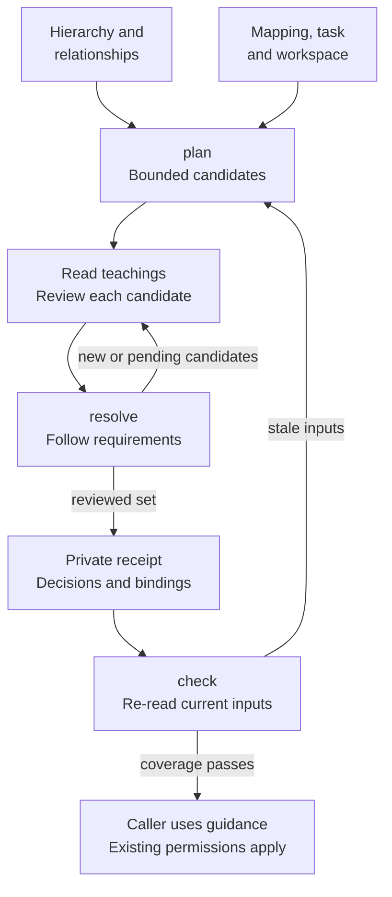

# Working context

`witful context` resolves the guidance for one work step from an explicitly selected
local collection. It implements the offline resolver and advisory pilot proposed in
[research RFC #64](https://github.com/astrivant/product-research/pull/64), reviewed
against [the source proposal](https://github.com/astrivant/product-research/blob/235d1529fb49954aa2211fbb33ca338be5426b4b/rfcs/context-aware-intelligence-traversal.md).

The resolver reports coverage. It neither authorizes the action nor installs a host
interceptor. Keep existing permissions, instance/sleeve guards, and the independent
[full-tree completion review](completion.md). A complete receipt establishes the
reviewed scope against a local snapshot; it does not establish truth, remote
freshness, successful execution, or simultaneous model recall.

## Review flow

How does one task select guidance without treating every retrieved statement as
applicable or authoritative?



The [resolver](../pkg/witful/context/core.py) follows outgoing `requires`
relationships and nominates optional `related`/`transfers` neighbors. It does not
infer use from graph proximity or application counts. The caller performs the
review and retains the selected text; a receipt alone does not place it in a
model's context. The separate [completion review](completion.md#review-lifecycle)
covers the full hierarchy at handoff rather than only this selected neighborhood.
See the [concept map](architecture.md#guidance-and-code-evidence) for how this
guidance differs from repository code evidence.

## First review

Use an existing Git-backed collection with a committed HEAD and ignored `.witful/`
storage. `witful init` supplies that ignore rule for new collections. Managed private
collections also require the existing [protected-storage checks](data-protection.md).
Commands use the installed package; development uses the locked project environment.

```bash
collection=/path/to/collection
umask 077
mkdir -p "$collection/.witful/context"
witful context --repo "$collection" snapshot > "$collection/.witful/context/snapshot.json"
witful context --repo "$collection" schema
witful --repo "$collection" show
```

Inspect the snapshot's identity ID, source revision, hierarchy digest, and original
`observed_at` epoch. Create a reviewed `knowledge/context.json` sidecar. This example
uses synthetic IDs; substitute the actual selected collection and concept IDs.
An empty rule list supports explicit task selections without an inferred mapping.

```json
{
  "version": 1,
  "scope": {
    "identity": "identity:local",
    "collection": "collection:example",
    "domain": "domain:example",
    "permission": "review:1"
  },
  "hierarchy_digest": "COPY_THE_REVIEWED_SNAPSHOT_DIGEST",
  "rules": [],
  "global_concepts": []
}
```

Store the step descriptor at `.witful/context/step.json`, using the same scope. The
permission reference records an independently reviewed policy. Matching strings
cannot grant filesystem access or permission to operate on another collection.

```json
{
  "scope": {
    "identity": "identity:local",
    "collection": "collection:example",
    "domain": "domain:example",
    "permission": "review:1"
  },
  "task": "task:example",
  "phase": "implementation",
  "action": "edit",
  "context_id": "context:1",
  "concepts": ["skill:testing"],
  "paths": ["pkg/example.py"],
  "refresh_trigger": "initial"
}
```

Read `observed_at` from the saved snapshot, retaining its original value for checks.
The following commands require `jq`. Repeat `--workspace` for every relevant Git
checkout. The collection itself is always fingerprinted.

```bash
observed_at="$(jq -r .observed_at "$collection/.witful/context/snapshot.json")"
witful context --repo "$collection" plan \
    --mapping "$collection/knowledge/context.json" \
    --descriptor "$collection/.witful/context/step.json" \
    --observed-at "$observed_at" \
    --workspace /path/to/project \
    --output "$collection/.witful/context/receipt.json"
```

The first plan normally exits **1**, with pending candidates. Inspect each candidate's
canonical ownership and typed inclusion paths, then read its source through
`witful --repo PATH show ID` or the journal. Write individual decisions in
`.witful/context/review.json`. This abbreviated example is not a complete review:

```json
{
  "version": 1,
  "decisions": [
    {
      "id": "skill:testing",
      "status": "applicable",
      "reason": "This step changes tested behavior.",
      "source": "review:task-example"
    }
  ]
}
```

Run `resolve` with the same arguments, adding `--decisions` and `--replace` to
explicitly replace the receipt. New applicable teachings can expose additional
prerequisites. Review those individually and repeat until complete or blocked.
Do not manufacture approvals to clear pending entries.

Before the next action, run `check` with the same mapping, descriptor, observation
epoch, workspaces, and decisions, replacing `--output` with `--input` and omitting
`--replace`. Add `--context-present` only if the exact loaded statements are still
available in this runtime context. The check independently reads current sources
and workspace state. It does not trust the saved receipt's success claim.

All `plan`/`resolve` operations write a receipt before reporting a valid incomplete
result. Exit **0** means complete coverage, **1** means incomplete/unmapped coverage
or a failed check, and **2** means invalid or unavailable inputs. `snapshot` and
`schema` return zero on success. Unexpected errors produce a redacted diagnostic.

## Mapping and applicability

The versioned sidecar is separate from the catalog. It binds to the compiled
hierarchy digest, including source teachings and relations. Source corrections
require reviewing the sidecar binding again; there is no automatic migration or
ownership reassignment. `context schema` generates closed JSON Schemas from the
same typed models used for validation.

Each rule has `id`, canonical `concepts`, review `source`, and optional integer
`priority`. Populated selector dimensions are ANDed; values within a dimension are
ORed. All matching rules contribute seeds. Priority orders matches and never
removes an overlapping requirement.

| Selector | Contract |
| --- | --- |
| `tags` | Exact bounded task tags |
| `paths` | Case-sensitive `fnmatch` over workspace-relative POSIX paths; `*` can match `/` |
| `phases`, `actions` | Exact phase/action classes |
| `resources` | Exact resource classes |
| `terms` | Reviewed exact aliases, normalized with NFKC, casefolding, and collapsed whitespace |
| `global_concepts` | Unconditional canonical requirements outside individual rules |

An unmapped task reports `unmapped`; an empty tree reports `no_local_guidance`.
Unclassified topics remain visible in their canonical home. There are no exclusion
rules, embedding providers, inferred ownership changes, usage rankings, or visual
proximity inputs in this implementation.

Selected concepts bring their ancestors, owned teachings, and sibling Skills under
the owning Discipline into review. Every applicable node follows outgoing
`requires` edges to a fixed point, including Lesson/Insight dependencies. Source
requires target; incoming requirements are not reversed. Required targets cannot be
excluded or deferred. Descendant teachings receive their own applicability slots.
Direct prerequisite edges order candidates before their dependents, with canonical
IDs breaking ties; ownership alone does not impose an execution dependency.

Incoming and outgoing `related`/`transfers` edges nominate optional supplemental
candidates one hop from selected or required origins. Promoting an optional candidate
to applicable follows its requirements, without recursively following all optional
neighbors. Duplicate paths deduplicate. Dangling edges, duplicate relation contracts,
requirement cycles, and invalid supersession fail closed.

A candidate is pending until individually judged `applicable`, `not_applicable`,
`blocked`, or, for optional supplemental material only, `deferred`. Every judgment
needs a reason and evidence reference. Excluding a parent cannot hide an applicable
child. Superseded teachings and their Insights remain `historical`; a requirement
on historical guidance is a conflict. Retrieved statements remain inert data, even
when their wording requests execution or publication.

## Inputs, budgets, and receipts

| Input | Purpose |
| --- | --- |
| `--repo` | Explicit authorized collection; never searches other identities |
| `--mapping`, `--descriptor` | Reviewed sidecar and current bounded task metadata |
| `--observed-at` | Original snapshot observation epoch, separate from current verification time |
| `--workspace` | Repeatable explicit Git checkout binding; includes staged, dirty, and nonignored files |
| `--decisions` | Individual sourced applicability dispositions |
| `--output`, `--replace` | Direct `.witful/context/*.json` output and explicit replacement consent |
| `--input`, `--context-present` | Previous receipt and retained-text attestation for `check` |
| `instance`, `sleeve` | Actual known runtime references in the descriptor; empty when unknown |
| `evidence_revision`, `context_id` | Invalidation markers for new evidence and runtime context generation |
| `refresh_trigger`, `prior_receipt` | Why a descriptor changed and the previous receipt digest, when known |

The optional mapping `limits` object defaults to 2,000 candidate nodes, 8,000 relation
edges, 1 MiB exact statement/provenance bytes, 8,000 conservative context tokens,
100 source-document reads, 2,000 ms retrieval time, and one optional hop. These are
fixture defaults, not measured production sizing. `max_age_seconds: 0` disables a
snapshot-age policy; `require_live: false` permits explicitly offline coverage.

The tokenizer contract is `utf8-byte-upper-bound-v1`. Compact context bytes include
the descriptor, candidate metadata and judgments, loaded exact text/provenance,
seeds, and matched rule IDs. Statement bytes are tracked separately. A budget
failure exposes `incomplete`, limiting diagnostics, and unmet IDs; required text is
never shortened. Receipt diagnostics themselves can exceed the active-context
budget and must not be mistaken for a successfully loaded context. Defer reviewed
optional material, split the task, or obtain a reviewed budget change.

The adapter caps each JSON/journal/catalog input at 4 MiB. Source-read accounting
covers mapping/descriptor/review documents and journal/catalog consistency reads;
it excludes Git workspace hashing and saved-receipt verification. Elapsed time is
measured for adapter retrieval. These are coverage limits, not process memory or
CPU isolation: compiler validation and filesystem operations still run, with the
existing bounded Git command timeout and per-file workspace size limit.

Receipts expose the descriptor, source revision, hierarchy/mapping/workspace digests,
execution profile, inclusion paths, judgments, loaded source hashes, consumed bytes,
coverage state, and blocked action. Content digests exclude operational verification
time and measured retrieval duration. Source observation time remains bound.
They are local integrity/freshness records, not signed authorizations or tamper-proof
claims against a writer who controls the entire collection.

## Refresh, confidentiality, and compatibility

Change the descriptor and re-resolve when the task, subsystem, action, evidence,
permission scope, or runtime changes. Give a new `context_id` after compaction,
resume, or delegation; a stored receipt does not reload text. Recheck source and
workspace bindings immediately before mutation. Capture is not a concurrent-writer
lock. Keep independent [instance](instances.md) and [sleeve](multisleeving.md) guards.

The CLI is offline. It reports the last locally observed commit and cannot establish
unseen remote changes or current external facts. `require_live: true` stays blocked
in this adapter. The pure API accepts explicit independently verified observations
from a caller, without following evidence URLs, invoking models, or executing text.
A fresh read cannot silently renew an old observation timestamp.

Only one explicitly authorized collection is loaded. Scope mismatch is rejected
before graph retrieval, and dangling/foreign targets produce redacted invalid
contracts without a foreign lookup. Scope labels are audit bindings, not a new ACL
service. Callers must authorize the selected root and trusted mapping independently.
No shared cache, remote provider, or cross-collection retrieval is installed.

Receipts, descriptors, and applicability evidence are private local runtime state.
Receipt files are mode `0600` beneath ignored, mode `0700` `.witful/context/` storage;
symlink destinations and escaped paths are rejected. Managed collection protection
also covers explicit inputs. Owners choose receipt retention and deletion; there
is no automatic export or cleanup promise. Reviewed `knowledge/context.json` is
included in the existing signed encrypted source archive allowlist, while runtime
receipts are excluded. This addition does not change historical catalog hashes,
replay inputs, encryption formats, or activate imported guidance.

## Validation and rollout

Synthetic tests cover deterministic closure, independent child review, directed
cross-discipline dependencies, optional promotion/deferral, supersession,
unmapped/Unclassified inputs, every resource bound, exact-binding refresh, offline
freshness, denied access before capture, inert malicious text, and the independent
final completion review. Filesystem tests exercise actual Git dirty-state changes,
private destinations, input ceilings, and archive round trips.

```bash
poetry run pytest -n 2 pkg/witful/context pkg/witful/completion pkg/witful/collection
poetry run pre-commit run --all-files
```

This implementation is an opt-in advisory pilot. Strict runtime gates, live-provider
adapters, probabilistic suggestions, and measured production budget recommendations
remain separate work. Disable the pilot by ceasing context invocations; preserve
accepted records, existing guards, and receipts needed for the owner's audit.
