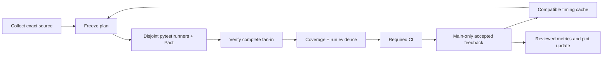
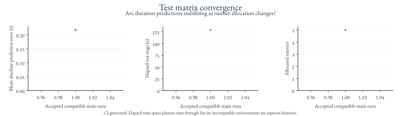

# Feature contracts and adaptive tests

A clean textual merge can still change what one feature expects from another.
The required Python test stage combines existing integration regressions with
consumer-driven [Pact tests](../tests/contracts/test_native.py). Pact records the
native client's request and response expectations, then replays them against the
actual composed Flask provider.<sup>[1](https://pact-foundation.github.io/pact-python/)</sup>

The contracts cover native record reads, absent-history refusal, malformed requests,
and CodeGraph/intent scope denial on both Git and PostgreSQL. A deliberately changed
provider response must fail verification. Binary CBOR bodies are compared exactly;
these are synthetic, same-revision contracts, not a compatibility promise for older
released clients. Pact files are retained with the shard artifacts. There is no
external Pact Broker or credential requirement.

The test socket adapter is loopback HTTP. It exercises the production client's
encoding, decoding and errors, while existing native transport tests independently
verify mutual TLS and real certificate handling. In-process feature composition,
including staged collection refresh and reflection history, remains covered by the
existing integration tests. Pact does not replace those tests or validate every
possible feature combination.

## Run locally

Use the locked development environment with the native extras. Point
`WITFUL_TEST_DATABASE_URL` at a disposable PostgreSQL instance: fixtures create and
remove isolated databases and roles. Without that variable, database-backed tests
report skips; hosted matrix workers always supply the test service.

```bash
PACT_DO_NOT_TRACK=1 poetry run pytest -n 4 tests/contracts tests/test_matrix
```

The native server needs no production keys or deployment. Only synthetic test
records and keys enter these tests.

## Adaptive matrix

The [test stage](../.github/workflows/stage-tests.yml) collects the complete pytest
suite, freezes a source-bound plan, then starts a variable-size matrix. Every test
has exactly one planned owner. Every worker rechecks collection against that plan;
fan-in rejects missing, duplicate, failed or mismatched results before combining
raw coverage or learning costs.

| Setting in [test-matrix.json](../.github/test-matrix.json) | Meaning |
| --- | --- |
| `threshold` | At or below this test count, use one runner; the default is 300 |
| `maximum` | Operator budget for hosted runners, bounded by the platform matrix limit |
| `workers` | Pytest processes per runner, matched to the selected runner size |
| `tolerance` | Relative elapsed-time equivalence window; prefer fewer runners within it |
| `default_seconds` | Cost estimate for a newly collected test |

On cold start, count-based partitions provide a baseline. Later runs use bounded
PID duration predictions and assign expensive tests first, with lexical tie-breaking.
The controller includes a deadband, anti-windup and a 25% per-run prediction slew
limit. Matrix sizing searches feasible counts for the lowest predicted elapsed time,
including learned overhead for previously observed counts. Unseen counts use the
current overhead estimate. It prefers fewer runners within the configured
equivalence window and changes at most one runner per accepted run. Small suites always return to one runner.
Runner count is the actuator; duration error drives the predictions.
The objective is elapsed completion time, not summed runner-seconds. Parallel work
counts once along the critical path. This bounded discrete search is not continuous
gradient descent and cannot establish a global minimum from unobserved allocations. Provider
rate limits are a separate concern.



## CI-owned convergence evidence

<!-- astrivant:test-convergence:start -->

<!-- astrivant:test-convergence:end -->

The figure is generated by Matplotlib in CI. It shows mean absolute prediction
error, elapsed test-stage time and allocated runners over compatible accepted
main runs. The initial figure reports missing history; it contains no invented
measurements. Skipped cases do not train timing predictions. The elapsed measurement spans the planner job's first step through successful
fan-in, including worker setup and intervening scheduling delays. Workflow queueing
before that first step and later publication are outside this test-stage boundary.
Other independent CI stages can still determine the complete pipeline's critical path.

The project keeps each artifact at an explicit ownership boundary:

| Location | Owner and retention |
| --- | --- |
| `.cache/ci/tests/plan.json` | Immutable per-run assignment, transferred by artifact |
| `.cache/ci/tests/shards/` | Same-run worker reports and raw coverage |
| `.cache/ci/tests/state.json` | Disposable PID state, restored from a compatible cache and saved only after successful main CI |
| `.github/metrics/tests/<run>-<attempt>.json` | Independent, reviewed aggregate record per accepted run |
| `docs/assets/test-convergence.svg` | CI-rendered view of compatible reviewed records plus the current accepted run |

Cache compatibility includes repository, Python/platform, lockfile, controller
code and configuration. Forks cannot silently inherit another repository's
measurements. A cache miss starts cold; malformed feedback fails validation.
PRs and tags run the checks but do not publish new feedback or history. Main-only
source captures precede releases, which retain the accepted documentation data.

The existing `generated-updates` job proposes the measured record and plot through
a signed, verified commit and a review PR. It does not bypass main protection.
If repository policy blocks bot-created PRs, the job supplies a compare link to
the signed proposal. Generated-only updates do not trigger another measurement
publication. Source changes are still tested, and all required checks gate writes.

The cached brand palette and bundled Garamond font keep rendering reproducible.
The renderer accepts explicit output destinations and repository/scope bindings.
New environments start a separate comparable series; older records remain available.
