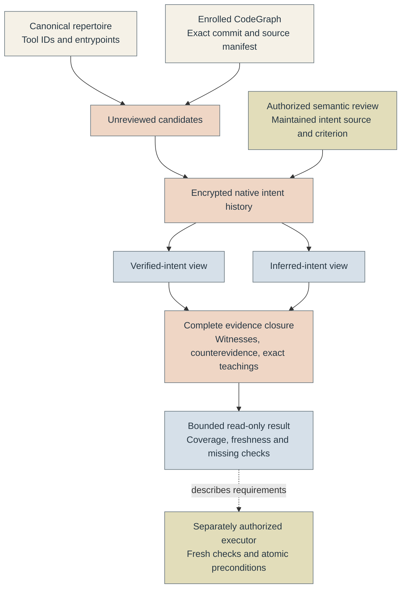

# Evidence-backed capability discovery

Find the tool that fits a task, inspect its intended behavior, and see which checks
remain. Witful joins the canonical repertoire to an enrolled CodeGraph and keeps
reviewed intent separate from inference. You can reuse a discovery result without
mistaking it for permission to publish, deploy or execute a helper.

## Architecture



The same Flask application owns mutual TLS, admission limits, operational metrics
and error handling. Intent and CodeGraph share the engineer's reserved native
scope, with separate refs inside one authenticated frontier. Native Git or
PostgreSQL stores only signed ciphertext. Refresh uses the existing fenced
compare-and-swap transaction and recovery path; an interrupted write cannot expose
half a projection. Generic record, export and sharing routes remain unavailable
for this scope.

The implementation follows [RFC #79](https://github.com/astrivant/product-research/pull/79).
The [typed models](../pkg/witful/intent/models.py),
[validation](../pkg/witful/intent/contracts.py),
[pure resolver](../pkg/witful/intent/core.py) and
[protected service](../pkg/witful/intent/service.py) own distinct contracts.

## What each result means

| Field | Meaning |
| --- | --- |
| `projection` | `verified` requires an explicit supported semantic review; otherwise the claim is inferred |
| `verification` | Latest supported, disputed, refuted or withdrawn review, or unreviewed |
| `freshness` | Validity of the declared source and input bindings, separate from past review |
| `coverage` | Exact question-scoped read receipts; parsing or retrieval never counts as semantic inspection |
| `conformance` | `unknown`; a declaration or bounded test does not prove universal implementation correctness |
| `result` | Discovery completeness: complete, incomplete or blocked |
| `readiness` | Not evaluated, or blocked for preflight; this API cannot issue a ready-to-execute receipt |
| `execution_authority` | Always not evaluated; permissions remain with the existing authority and action executor |
| `generation` | Exact native intent revision for a conditional update |
| `output_bytes`, `limits` | Complete compact JSON size and applied query budgets |

A narrow intent claim can be verified while implementation reading is partial.
Every coverage receipt partitions its named file universe into inspected,
uninspected, unavailable and excluded byte ranges. Gaps and overlaps fail
validation. Excluded files remain in the denominator and never count as inspected.
A receipt states the inspector, question, method, time and limitations; it does
not claim comprehension.

Default verified queries exclude stale, disputed, withdrawn and superseded claims.
`--history` includes qualified history retained in the current source projection.
Prior source generations remain in encrypted native ancestry. They are never
silently rebound to a new commit, renamed symbol or CodeGraph generation.

## Enable discovery on an enrolled graph

First establish the [CodeGraph custody and runtime](codegraphs.md). The feature
uses its existing deployment settings, keys, certificate and repository scope.
It creates no vault, key, runtime or graph enrollment on installation.

Provision only the required native actions through the existing administration
workflow:

| Action | Purpose |
| --- | --- |
| `intent-query` | Prepare an unpublished draft, discover intent and retrieve exact source ranges |
| `intent-write` plus `write` | Publish an unreviewed candidate with an expected intent revision |
| `intent-review` plus `write` | Append an explicit semantic decision with authenticated reviewer attribution |

Existing grants acquire none of these permissions automatically. A writer cannot
submit fabricated reviews through the publication endpoint. The review endpoint
assigns the actual mTLS peer, current grant/policy/task binding and recording time.
Schema checks establish structure and provenance bindings; the authorized reviewer
is responsible for the adequacy of the stated intent source and criterion.

Client configuration and process output retain the CodeGraph protection contract.
The CLI requires `--pipe`, refuses regular-file or terminal output, and accepts
publication proposals through a pipe on stdin. The recipient must be an admitted,
non-logging memory consumer. Do not redirect private drafts or responses into
ordinary files, logs or CI artifacts.

```bash
witful intent find publish --client /protected/client.json --pipe \
  --view both --tokens 12000 --bytes 16000 | admitted-memory-consumer
witful intent explain ASSERTION_ID --client /protected/client.json --pipe \
  --tokens 20000 --bytes 24000 | admitted-memory-consumer
witful intent coverage ANCHOR_ID --client /protected/client.json --pipe \
  --tokens 12000 | admitted-memory-consumer
witful intent preflight tool:publication-helper --action publish \
  --client /protected/client.json --pipe | admitted-memory-consumer
witful intent affected --changed input:configuration \
  --client /protected/client.json --pipe | admitted-memory-consumer
```

`admitted-memory-consumer` names your reviewed recipient, not an executable shipped
by Witful. Empty discovery vocabulary lists the admitted scope within the same
limits. Results never search across identities or repositories.

### Prepare and review a candidate

`witful intent draft` reads a canonical `Inventory` JSON snapshot from stdin and
returns an unpublished `State`. It joins existing tool IDs and local entrypoint
paths to the current graph. All generated assertions are inferred, with no review
or semantic reading receipt. Preparing or querying a draft does not increment tool
use, create lessons or modify inventory.

Submit the reviewed candidate through `witful intent publish --client PATH
--pipe --operation UUID --initial`, with the `State` on stdin. For a refresh, replace
`--initial` with `--expected INTENT_REVISION` from a current query. A matching
operation retry returns its original durable receipt; changed retry inputs conflict.

`witful intent review --client PATH --pipe --operation UUID --expected INTENT_REVISION`
accepts a `Review` on stdin. Leave `reviewer`, `authority` and `binding` empty and
`reviewed` zero so the server can supply them. Name the precise assertion, versioned
criterion, maintained intent-declaration evidence and rationale. A subsequent
review names its predecessor. Withdrawals and refutations append history.

Generate machine-readable contracts directly from the public Python models with
`witful.knowledge.contracts.schema(State)`, `schema(Query)` and `schema(Result)`.
Unknown fields and coercible wrong types are rejected at the API boundary.

## Witnesses, freshness and missing checks

A `Requirement` contains alternative `Bundle` records. Every bundle is a complete
AND witness; `selected` freezes one reviewed OR choice. The resolver does not
optimize or mix alternatives. It checks required evidence classes, common
provenance roots when independence is required, freshness and recursively grounded
prerequisites. Cyclic justifications and undeclared empty witnesses are rejected.

Closure includes global requirements, explicit `--required` IDs, exact mandatory
teaching text and all known counterevidence. Missing mandatory inputs block the
result; a budget limit returns incomplete instead of pruning necessary evidence.
A requirement may explicitly permit disclosure of its own missing-check ID.
Unknown member IDs, labels, counts and topology remain absent from blocked output.
For example, build evidence alone cannot satisfy a release witness that also
requires a signed tag, destination publication, fresh download and independent
artifact verification. Its disclosed obligation can be `publication_unverified`.

Each semantic review binds the complete declared input and evidence snapshot.
Changed configuration, parser, query/schema contract, repertoire, lockfile or
supporting evidence makes that review stale. This deliberately conservative
binding can require re-review after an additive evidence change. Reverse dependency
closure identifies affected records deterministically; history remains unchanged.
A new CodeGraph generation requires a newly bound intent candidate.

The pure Python resolver accepts explicit fresh `Observation` values from a trusted
orchestration boundary. HTTP clients cannot assert their own live observations.
The HTTP facade therefore leaves live worktree/index, remote, authentication and
approval checks missing when a procedure requires them. `preflight` describes
those requirements; it does not run checks, stage files, log in or publish anything.
An action executor still needs fresh independent approval and an atomic destination
precondition. An unchanged HEAD or a recently issued discovery receipt cannot
establish that boundary.

Source retrieval uses `witful intent source ANCHOR_ID --digest SHA256 --start N
--end N --client PATH --pipe`. Both offsets are byte offsets inside the named
anchor. The service verifies exact current source, expected digest and bounds,
then rechecks authority before release. Instructions inside source are inert data.

## Validation and operational limits

Synthetic tests cover independent evidence dimensions, exact coverage partitions,
complete witnesses, dependent corroboration, counterevidence, cycles, stale review
bindings, live observations, bounded output and encrypted native persistence.
Git and PostgreSQL integration tests exercise real authenticated encryption,
PyCasbin grants, conditional publication, review attribution, rotation, refresh,
concurrent candidates and generic-route denial. CI runs them with its existing
isolated PostgreSQL service.

Run focused checks with `pytest tests/intent`. Native tests require the documented
`WITFUL_TEST_DATABASE_URL` for a disposable database and otherwise skip explicitly.
These checks do not establish semantic adequacy, production enrollment, reduced
model-token use or improved answer quality. No model service, telemetry, external
optimizer or plaintext search cache is installed by this feature.
