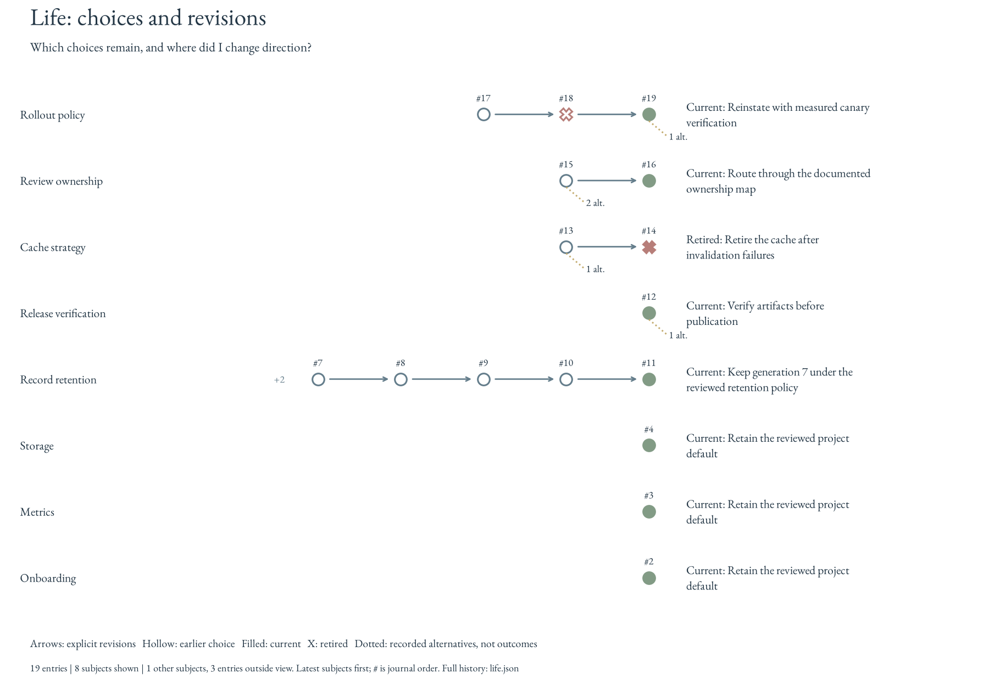

# Life: decisions worth returning to

Life preserves what was chosen, the constraints behind it, and the evidence that
could make that choice worth revisiting. Lessons describe reusable guidance;
decisions show how that guidance was applied to a particular task. A later agent
can retrieve those choices before acting, then record a supported revision when
the circumstances warrant one.

## Set up an agent's decision workflow

Use an existing [Witful collection](private-collections.md), its reviewed guidance
and its configured encryption/signing keys. Collection creation and key provisioning
remain explicit setup operations. Install the released Witful package, then point
the agent's project instructions at the collection's `SKILL.md`. This workflow is
agent-independent; it needs no extra model provider, background agent or database.

```bash
witful --help
witful life --repo COLLECTION check
witful life --repo COLLECTION schemas
witful life --repo COLLECTION show
```

Check the installed command's help before using filters introduced by a newer
release. A missing journal is an empty history, not an invitation to reconstruct
old decisions. Key or collection validation failures must be resolved through the
collection's documented recovery procedure; never bypass protection or silently
generate replacement keys.

For the first real choice, prepare a reviewed JSON document on protected working
storage. Replace the example concept with an existing ID from `witful show`:

```json
{
  "key": "project:storage",
  "title": "Select project storage",
  "task": "project:issue-42",
  "choice": "Use the reviewed database service",
  "rationale": "The deployment requires shared transactional state",
  "source": "Reviewed issue or design reference",
  "concept_ids": ["skill:storage"],
  "alternatives": [],
  "status": "accepted"
}
```

```bash
witful life --repo COLLECTION record --input /protected/decision.json
witful life --repo COLLECTION check
```

The example is a format illustration, not a decision to import unchanged. Record
choices when they become concrete, including engineer-directed changes, and check
for unrecorded dispositions at handoff. Preserve the emitted event ID for an
explicit revision. Identical retries are idempotent. Publish the reviewed journal
and replay snapshots through the collection's existing protected publication
workflow; its main pipeline owns routine figure refreshes. An uncommitted local
record cannot update the hosted dashboard.

## Consult, decide, record

Before a consequential choice, inspect related current decisions using a stable
subject key, an exact concept ID, or an exact task identifier:

```bash
witful life --repo COLLECTION show --concept skill:storage --limit 10
witful life --repo COLLECTION show --key project:storage --history
witful life --repo COLLECTION show --task project:issue-42 --limit 5
```

Filters combine with AND. Concept matching covers direct recorded references;
it does not infer ancestry or semantic similarity. `--limit` selects the newest
matches in journal order. Without a limit, the existing key order for current
decisions is preserved. Retired heads stay visible so an earlier choice cannot
silently return as current. `--history` includes superseded events.

Read the choice, task, rationale and evidence together. Decide whether the old
constraints still apply; a matching concept does not establish that they do.
Current user instructions and authority remain controlling. Life is a retrieval
and audit mechanism, not automatic execution or model training.<sup>[1](#references)</sup>

Record the resulting choice with `life record --input decision.json`. Reuse a
stable `key` when revising that same subject and set `supersedes` to its current
event ID. New subjects get independent keys. Record only documented alternatives,
concise rationale and actual evidence. Do not reconstruct hidden deliberation or
give an unexecuted alternative an observed outcome. Complete existing decisions
are defined by [`Decision`](../pkg/witful/life/models.py); generate the current
input schema with `witful life schemas`.

At handoff, check whether a consequential choice was recorded or explicitly left
unresolved. Periodic [reflection](continual-learning.md) revisits those records
against newer evidence. Recording, consulting and assessing a decision are three
different actions; none should be inferred merely from a rendered chart.

## Read the compact paths

```bash
witful life --repo COLLECTION build
PYTHONPATH=pkg python -m scripts.documentation.life_example --output .cache/life-example
```

The second command creates **synthetic review data only**. It demonstrates
revision, retirement, reinstatement, independent subjects and consolidated history.



Each row is one decision subject. Arrows connect explicit revisions; they do not
connect unrelated choices just because one was recorded after another. Hollow
circles are earlier accepted choices, filled circles are current choices, and
crosses are retired choices. Dotted branches count documented alternatives, not
paths that were executed. Journal entry numbers identify the retained source.

The overview shows the eight most recently updated subjects and up to five events
per subject, ending at each current head. A `+N` prefix counts earlier revisions.
The footer accounts for other subjects and all entries outside the view. Recency
is journal order, not an inferred date or importance score. Full events, choices,
alternatives, sources and the selected view remain in `life.json`; aggregation
does not delete them. The separate decision-influences figure retains concept
counts without treating them as proficiency.

The existing collection main workflow regenerates `life.svg` and `life.png`.
No new background process is required. Readable figures disclose their labels:
publication continues to use the collection's existing opt-in. Full JSON and
replay inputs remain under its protected-storage policy. Historical replay still
requires explicit acknowledgement when the renderer or its packaged assets differ.

## References

1. [Agent workflow](../SKILL.md#consult-decisions-before-acting) and
   [review assessments](continual-learning.md#review-a-batch) define the retrieval
   and evidence boundaries; neither grants new action authority.
