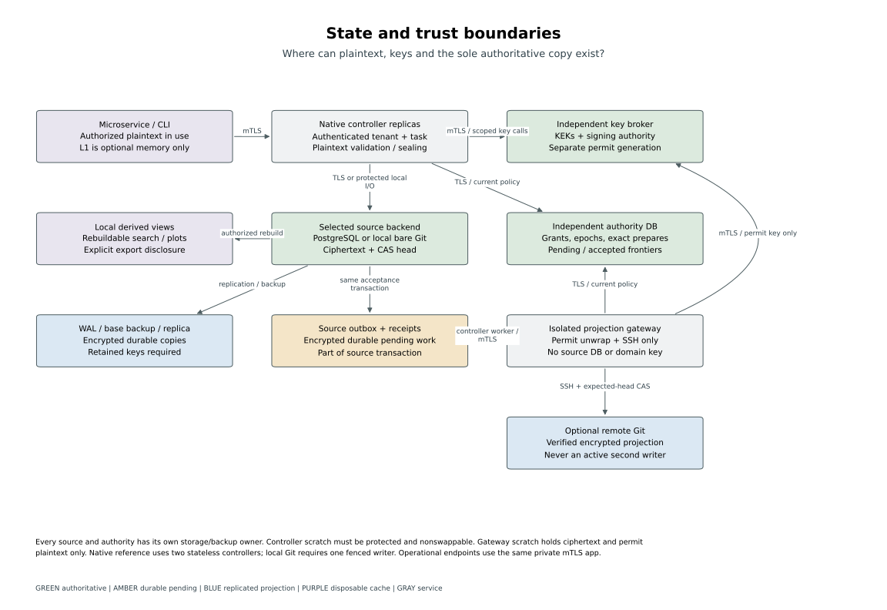
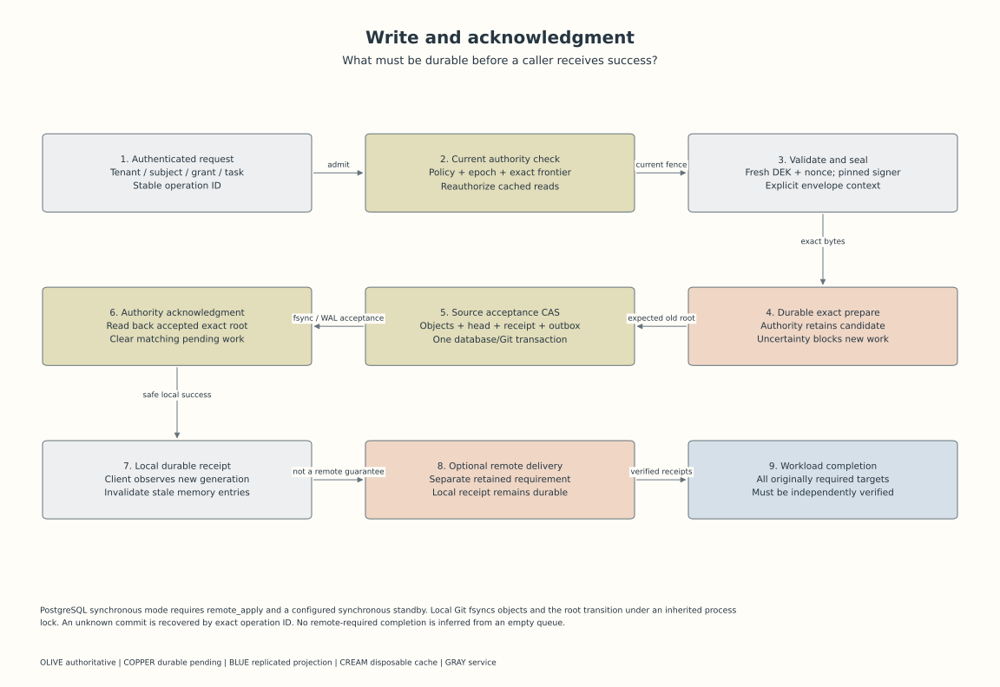
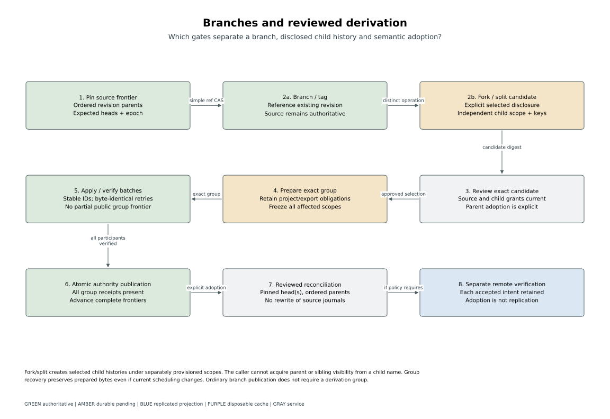
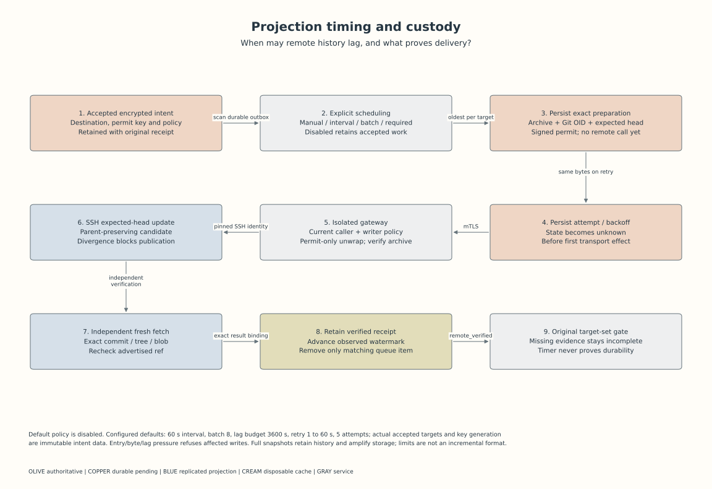
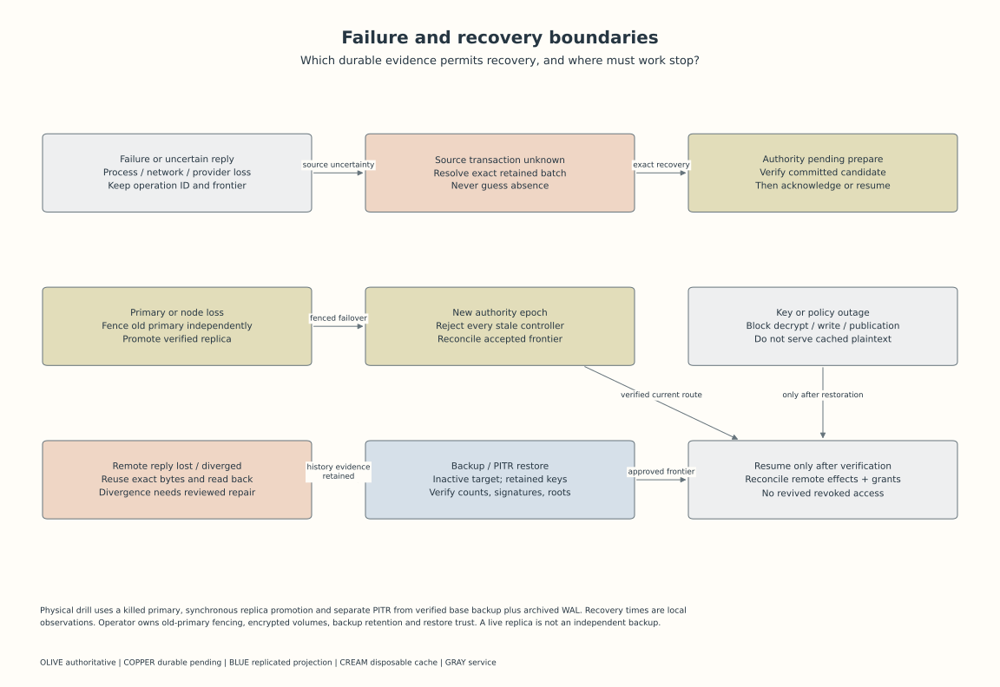
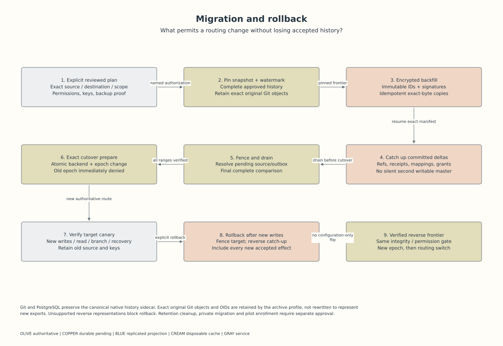

# Native storage diagrams

These six views describe the implemented native contracts and the synthetic/reference
profiles verified with this PR. Each view answers a concrete review question and links
the implementation it describes. They do not represent a privately enrolled deployment.

<!-- TOC -->
<!-- /TOC -->

The [shared diagram palette](../../architecture.md#reading-the-diagrams) follows
the README logo. Olive identifies authoritative state, copper pending work, blue
projections, cream disposable caches and gray services. Labels and arrows retain
the precise contract; color alone never establishes authorization or durability.

<!-- toc:start -->
**Table of contents**

- [Source and configuration binding](#source-and-configuration-binding)
- [Views](#views)
- [Verification scope](#verification-scope)
<!-- toc:end -->

## Source and configuration binding

[manifest.json](manifest.json) records the source commit, verification date, format
versions, reference configuration digests, exact implementation/schema inputs and
rendered output hashes. [views.json](views.json) is the editable source for all views;
the [renderer](../../../scripts/native/diagrams.py) uses the project's locked plotting
stack. Configuration placeholders remain placeholders. A production pilot must replace
them with its reviewed configuration and verify every trust/storage boundary.

To regenerate after reviewing changed code or configuration:

```bash
python -m scripts.native.diagrams --date YYYY-MM-DD --preview .cache/native-diagrams
python -m scripts.native.diagrams --check
```

Inspect each PNG preview before staging its SVG and manifest. The shared check runs
in pre-commit and CI and refuses changed inputs or output bytes. It proves freshness,
not the truth of labels or a deployed host's protection controls. The manifest binds
exact source bytes; font/rendering differences across toolchains need another visual
review rather than a claim of universal byte-identical output.

The renderer uses [SVG comma separators](https://www.w3.org/TR/SVG2/paths.html#PathDataBNF)
between numeric path coordinates. This keeps geometry distinct from phone-shaped
text for the existing scanner; labels and the PII gate remain unchanged.

## Views

| View | Review purpose | Representative implementation |
| --- | --- | --- |
| [State and trust](state-trust.svg) | Locate authoritative state, pending work, projections, caches, keys and plaintext boundaries | [Controller](../../../pkg/witful/native/application.py), [gateway](../../../pkg/witful/native/projection/application.py), [configuration](../../../pkg/witful/native/config.py) |
| [Write and acknowledgment](write-ack.svg) | Trace exact preparation, source CAS, authority acknowledgment and remote-required completion | [Service](../../../pkg/witful/native/service.py), [authority](../../../pkg/witful/native/authority.py), [verification](../../../pkg/witful/native/projection/verification.py) |
| [Branches and review](branches-review.svg) | Distinguish references, reviewed disclosure, grouped publication and adoption | [Derivation](../../../pkg/witful/native/derivation.py), [reconciliation](../../../pkg/witful/native/reconciliation.py) |
| [Projection timing](projection.svg) | Trace scheduling, exact bytes, isolated publication, readback and watermarks | [Worker](../../../pkg/witful/native/projection/worker.py), [transport](../../../pkg/witful/native/projection/transport.py) |
| [Failure and recovery](recovery.svg) | Identify retained recovery evidence and conditions that block resumption | [Settlement](../../../tests/native/test_settlement.py), [physical recovery](../../../tests/native/test_physical.py) |
| [Migration and rollback](migration.svg) | Trace forward and reverse catch-up through an epoch-fenced cutover | [Migration](../../../pkg/witful/native/migration.py), [original Git archive](../../../pkg/witful/native/original_git.py) |













## Verification scope

The [acceptance report](../acceptance.md) maps these views to actual fault tests,
transport tests, physical recovery receipts and the bounded benchmark. The native
reference selects PostgreSQL with synchronous application and two stateless
controllers. The separate projection reference selects one fenced gateway writer.
The alternative local-Git source requires a single writer. The default chart profile
does not silently enable either service or migrate an existing managed collection.

A reviewer should trace one normal write, one lost acknowledgment, one required
projection and one reverse migration against the code and retained test evidence.
A private pilot must repeat this review against its real network, storage, authority,
key-custody and backup configuration before activation.
